# Rendered carousels

JPGs for TikTok (1080×1920) and Instagram (1080×1350), rendered by `social/render/render.py` from the scripts in `docs/social/`. Photos are illustrative and are not always of the place named on a slide; no slide pairs a place name with a photo of a different named place.

## Taverna bill: myths vs facts

Folder: [`01-taverna-bill-myths/`](01-taverna-bill-myths/) · format: Myths vs facts · links to https://vasilismis.github.io/greece-honestly/articles/greek-taverna-etiquette/

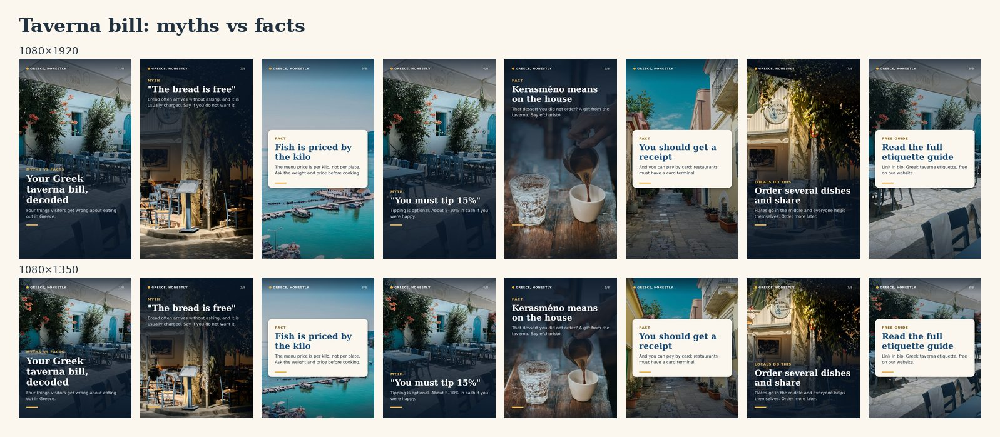

**Caption**

Bread on the bill? Fish by the kilo? Here is how a Greek taverna bill really works, so nothing surprises you. Free guide on our site. AI characters, written in Greece. #greece #greekfood #taverna #greecetravel #traveltips #eatlikealocal

## Which Greek island are you?

Folder: [`02-island-quiz/`](02-island-quiz/) · format: Quiz · links to https://vasilismis.github.io/greece-honestly/articles/which-greek-island-is-right-for-you/

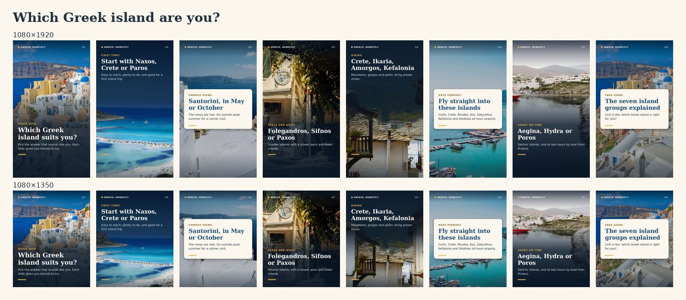

**Caption**

First trip, quiet escape, hiking or no ferries? Seven answers, seven sets of islands. Which one are you? Full guide on our site. AI characters, written in Greece. #greekislands #greece #islandhopping #greecetravel #travelquiz #visitgreece

## Ordering coffee: say this, not that

Folder: [`03-coffee-say-this/`](03-coffee-say-this/) · format: Say this, not that · links to https://vasilismis.github.io/greece-honestly/articles/how-to-order-coffee-in-greece/

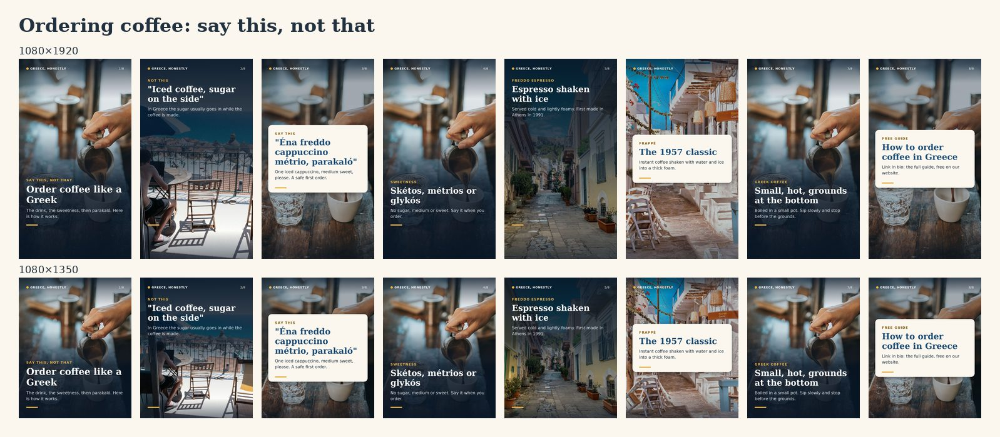

**Caption**

Skétos, métrios or glykós? In Greece you choose the sugar when you order, not after. Learn the one sentence that gets you the perfect freddo. AI characters, written in Greece. #greekcoffee #freddoespresso #greece #learngreek #coffeelover #greecetravel

## The 7% tax in numbers

Folder: [`04-seven-percent-numbers/`](04-seven-percent-numbers/) · format: Money numbers · links to https://vasilismis.github.io/greece-honestly/articles/greece-7-percent-flat-tax-foreign-pensions/

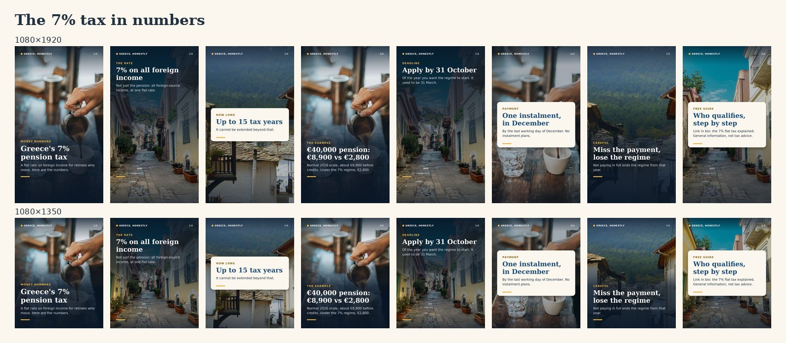

**Caption**

A €40,000 foreign pension: about €8,900 on the normal Greek scale, or €2,800 under the 7% regime. Who qualifies, and the dates you cannot miss. AI characters, written in Greece. #retireingreece #greece #expatlife #retirementplanning #movingabroad #greektax

## Things locals do at a Greek café

Folder: [`05-cafe-locals/`](05-cafe-locals/) · format: Things locals do · links to https://vasilismis.github.io/greece-honestly/articles/greek-phrases-for-your-first-week/

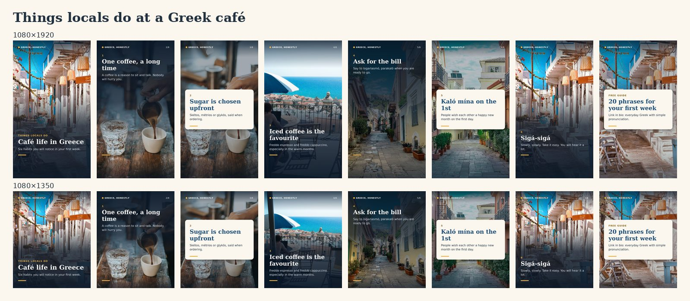

**Caption**

One coffee, a long chat, the sugar chosen upfront and kaló mína on the 1st. Six café habits you will spot in your first week in Greece. AI characters, written in Greece. #greece #greeklife #cafeculture #learngreek #slowtravel #greecetravel

## Digital nomad visa: myths vs facts

Folder: [`06-nomad-myths/`](06-nomad-myths/) · format: Myths vs facts · links to https://vasilismis.github.io/greece-honestly/articles/greece-digital-nomad-visa-2026/

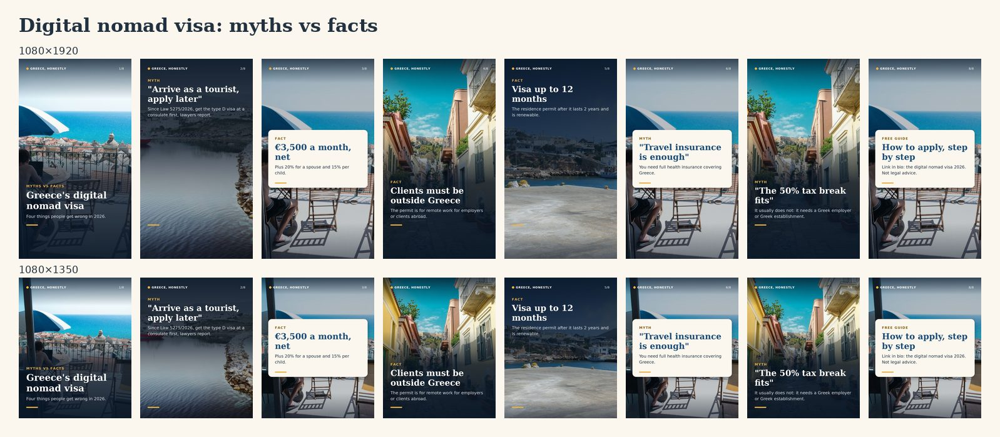

**Caption**

Arrive as a tourist and apply later? Not any more. The 2026 rules for Greece's digital nomad visa, minus the myths. AI characters, written in Greece. #digitalnomad #greece #remotework #workfromanywhere #nomadlife #movingabroad

## Financially Independent Person permit in numbers

Folder: [`07-fip-numbers/`](07-fip-numbers/) · format: Money numbers · links to https://vasilismis.github.io/greece-honestly/articles/retiring-to-greece-2026/

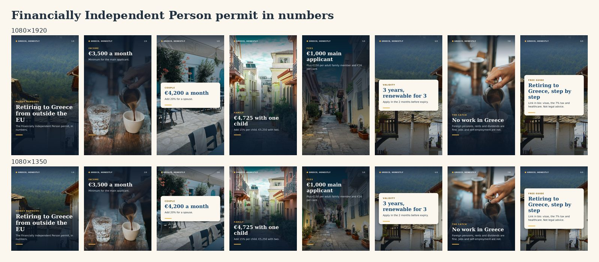

**Caption**

Retiring to Greece from outside the EU? The Financially Independent Person permit: €3,500 a month, €4,200 for a couple, no work in Greece. AI characters, written in Greece. #retireingreece #greece #retirement #expatlife #movingabroad #residencepermit

## Ne means yes: say this, not that

Folder: [`08-yes-means-no/`](08-yes-means-no/) · format: Say this, not that · links to https://vasilismis.github.io/greece-honestly/articles/greek-phrases-for-your-first-week/

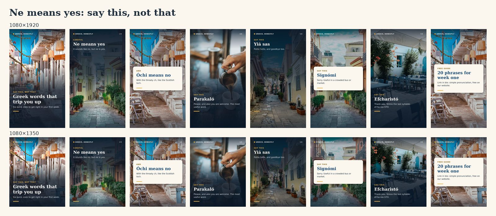

**Caption**

In Greek, ne means yes and óchi means no. Six small words that make a big difference in your first week. Save this one. AI characters, written in Greece. #learngreek #greeklanguage #greece #greekwords #languagelearning #greecetravel

## Greek alphabet quiz

Folder: [`09-alphabet-quiz/`](09-alphabet-quiz/) · format: Quiz · links to https://vasilismis.github.io/greece-honestly/articles/how-to-read-greek-signs-alphabet/

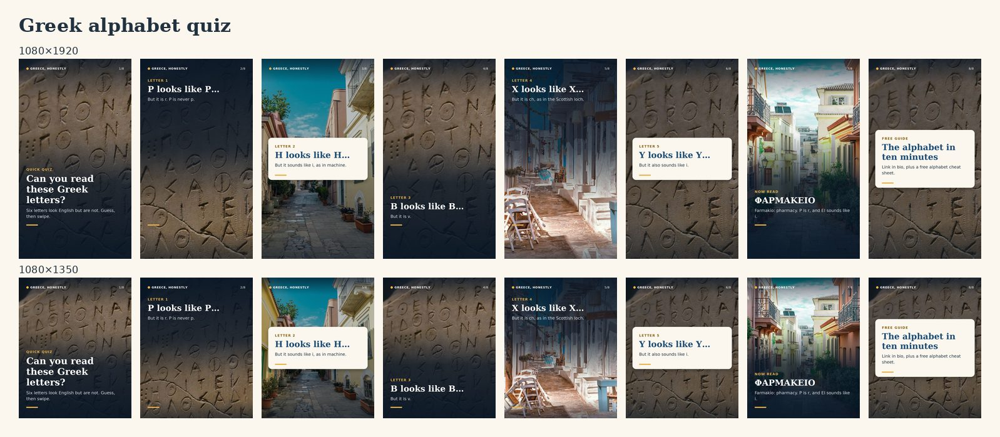

**Caption**

Ρ is r, Η is i and Β is v. Can you read ΦΑΡΜΑΚΕΙΟ by the end? Six letters that look English but are not. AI characters, written in Greece. #greekalphabet #learngreek #greece #languagelearning #greeklanguage #travelgreece

## Things locals say

Folder: [`10-greek-habits/`](10-greek-habits/) · format: Things locals do · links to https://vasilismis.github.io/greece-honestly/articles/greek-phrases-for-your-first-week/

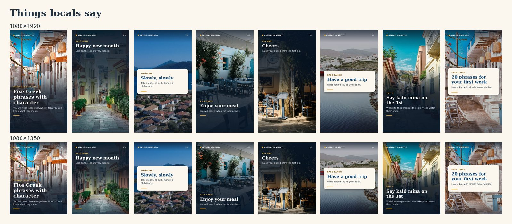

**Caption**

Kaló mína, sigá-sigá, yiá mas: the little Greek phrases you will hear every day, and when to use them yourself. AI characters, written in Greece. #learngreek #greece #greekculture #greekphrases #languagelearning #slowtravel

## Greek islands in winter: myths vs facts

Folder: [`11-winter-islands-myths/`](11-winter-islands-myths/) · format: Myths vs facts · links to https://vasilismis.github.io/greece-honestly/articles/greek-islands-in-october-and-november/

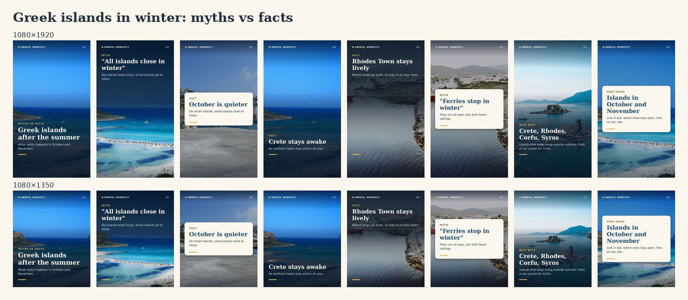

**Caption**

Do the Greek islands close in winter? The small ones mostly do. The big ones keep living. Where to go in October and November. AI characters, written in Greece. #greekislands #greece #offseason #autumntravel #crete #slowtravel

## Greek tax scale 2026

Folder: [`12-tax-scale-numbers/`](12-tax-scale-numbers/) · format: Money numbers · links to https://vasilismis.github.io/greece-honestly/articles/retiring-to-greece-2026/

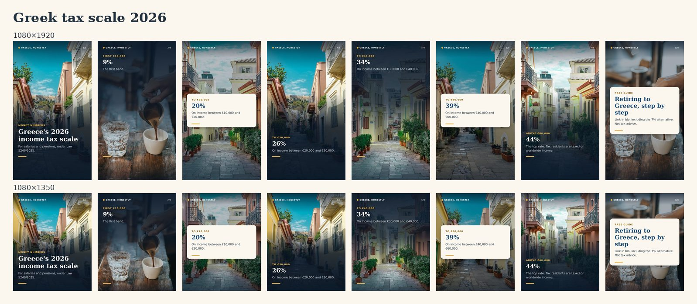

**Caption**

Greece's 2026 tax scale for salaries and pensions: from 9% on the first €10,000 to 44% above €60,000. Save it for later. AI characters, written in Greece. #greektax #greece #expatlife #movingabroad #personalfinance #retireingreece

## At the pharmacy: say this

Folder: [`13-pharmacy-say-this/`](13-pharmacy-say-this/) · format: Say this, not that · links to https://vasilismis.github.io/greece-honestly/articles/greek-phrases-for-the-pharmacy-and-doctor/

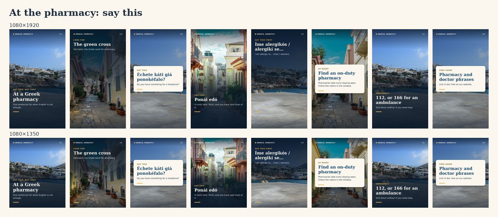

**Caption**

A headache, sunburn, a sore throat. Five Greek sentences for the pharmacy, and how to find one open at night. AI characters, written in Greece. #learngreek #greece #traveltips #greecetravel #greekphrases #travelhealth

## Ferry habits of people who know

Folder: [`14-ferry-locals/`](14-ferry-locals/) · format: Things locals do · links to https://vasilismis.github.io/greece-honestly/articles/greek-ferries-how-to-book/

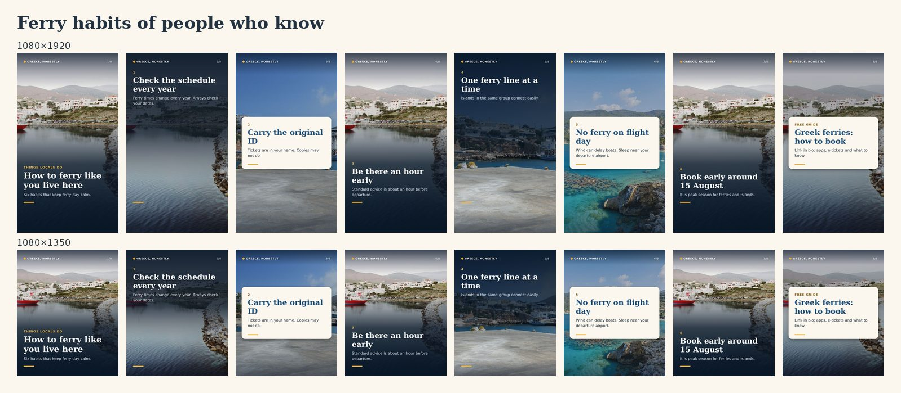

**Caption**

Original ID, an hour early, one ferry line and never a ferry on flight day. Six habits that keep Greek ferry days calm. AI characters, written in Greece. #greekferries #greekislands #islandhopping #greece #traveltips #greecetravel

## Lefkada quiz

Folder: [`15-lefkada-quiz/`](15-lefkada-quiz/) · format: Quiz · links to https://vasilismis.github.io/greece-honestly/articles/lefkada-travel-guide/

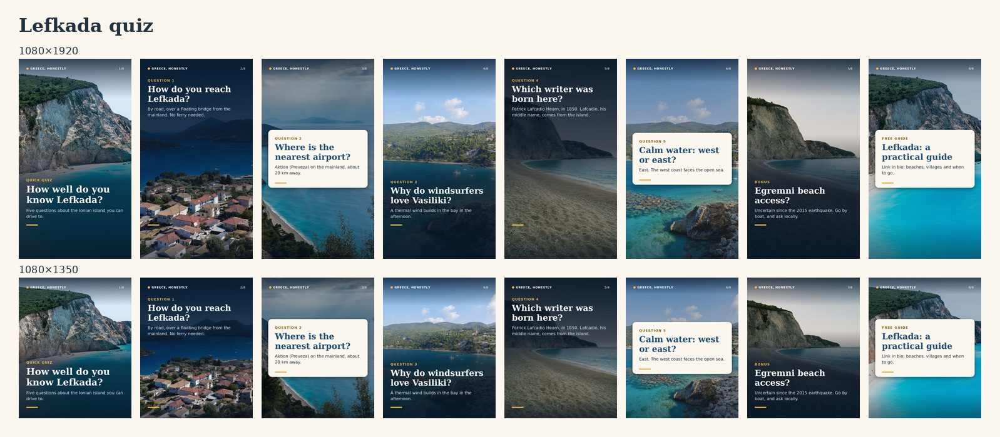

**Caption**

A floating bridge, a famous afternoon wind and a writer whose middle name comes from the island. How many of these Lefkada questions can you answer? AI characters, written in Greece. #lefkada #lefkas #ionianislands #greece #greekislands #travelquiz

## Renting in Greece: myths vs facts

Folder: [`16-renting-myths/`](16-renting-myths/) · format: Myths vs facts · links to https://vasilismis.github.io/greece-honestly/articles/renting-a-flat-in-greece/

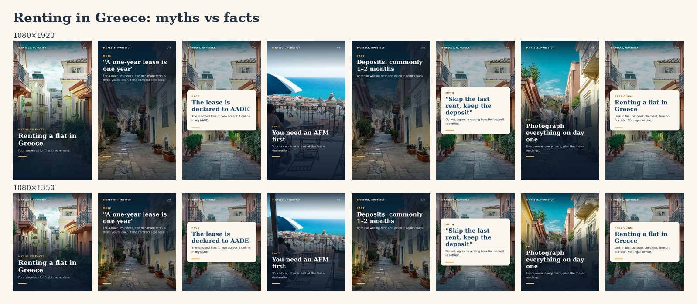

**Caption**

A one-year lease that lasts three years? Registering with the tax office? What surprises first-time renters in Greece, and how to be ready. AI characters, written in Greece. #rentingreece #athens #greece #expatlife #movingabroad #firstapartment

## Golden Visa in numbers

Folder: [`17-golden-visa-numbers/`](17-golden-visa-numbers/) · format: Money numbers · links to https://vasilismis.github.io/greece-honestly/articles/retiring-to-greece-2026/

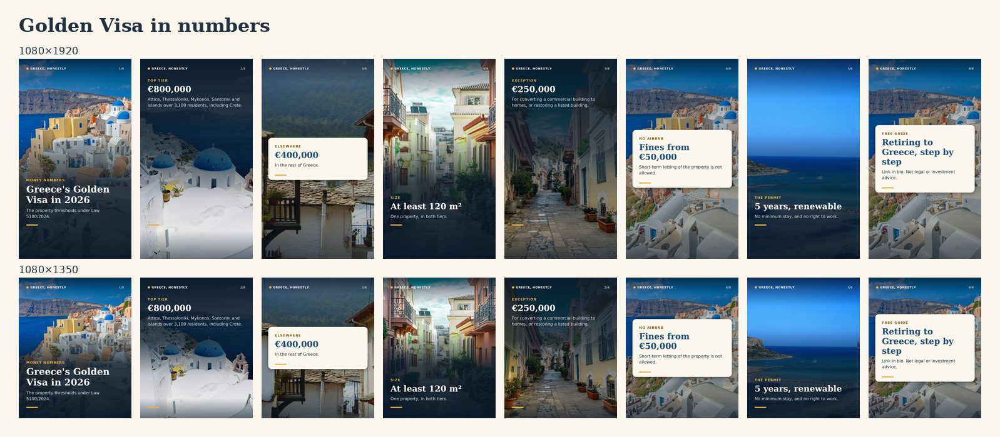

**Caption**

€800,000, €400,000 or €250,000: Greece's Golden Visa thresholds, the 120 m² rule and the short-term rental ban, in eight slides. AI characters, written in Greece. #goldenvisa #greece #realestate #residencybyinvestment #movingabroad #greekproperty

## First 90 days: myths vs facts

Folder: [`18-first-90-myths/`](18-first-90-myths/) · format: Myths vs facts · links to https://vasilismis.github.io/greece-honestly/articles/first-90-days-in-greece/

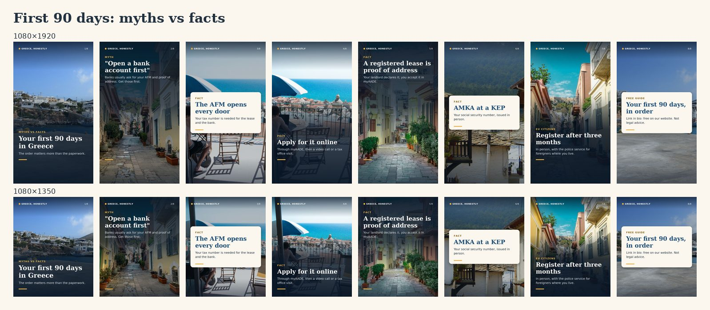

**Caption**

Bank first? Not in Greece. AFM, phone, a registered lease, then the bank and AMKA. The order that saves you second trips. AI characters, written in Greece. #movingtogreece #greece #expatlife #movingabroad #greekbureaucracy #newbeginnings

## Greek holidays 2027 quiz

Folder: [`19-holidays-quiz/`](19-holidays-quiz/) · format: Quiz · links to https://vasilismis.github.io/greece-honestly/articles/greek-public-holidays-2027/

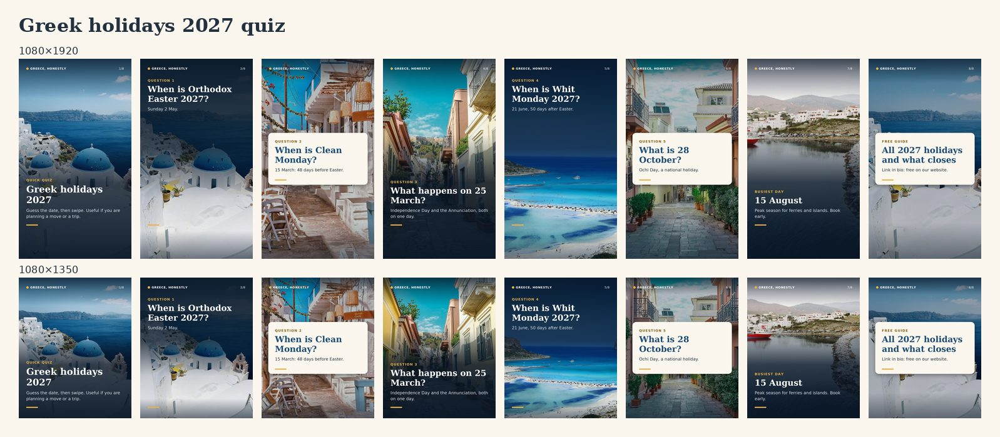

**Caption**

Orthodox Easter 2027 is on 2 May. Do you know when Clean Monday and Whit Monday fall? Quiz yourself before you plan. AI characters, written in Greece. #greece #greekholidays #greekeaster #travelplanning #greekculture #visitgreece

## Island hopping: myths vs facts

Folder: [`20-island-hopping-myths/`](20-island-hopping-myths/) · format: Myths vs facts · links to https://vasilismis.github.io/greece-honestly/articles/greek-island-hopping-three-routes/

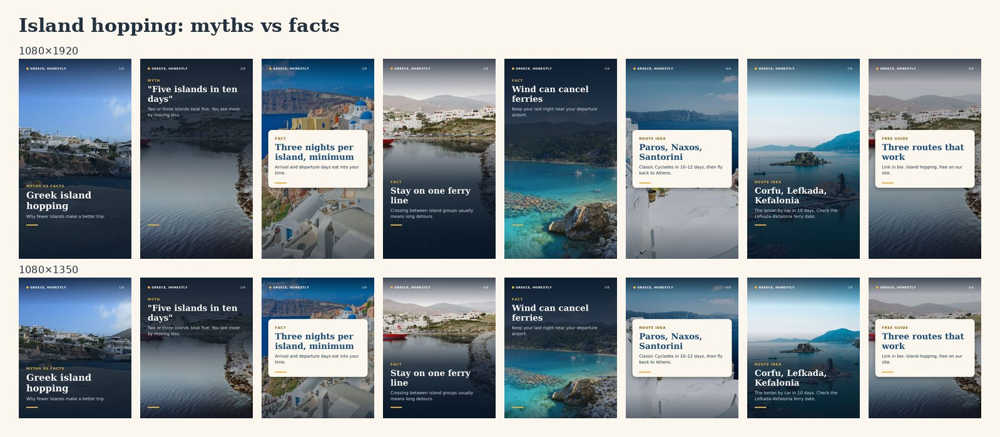

**Caption**

Five islands in ten days sounds great until you spend it in ports. Two or three islands, three nights each. Here is why. AI characters, written in Greece. #islandhopping #greekislands #greece #cyclades #travelplanning #greecetravel

## Which Ionian island suits you?

Folder: [`21-ionian-quiz/`](21-ionian-quiz/) · format: Quiz · links to https://vasilismis.github.io/greece-honestly/articles/ionian-islands-compared/

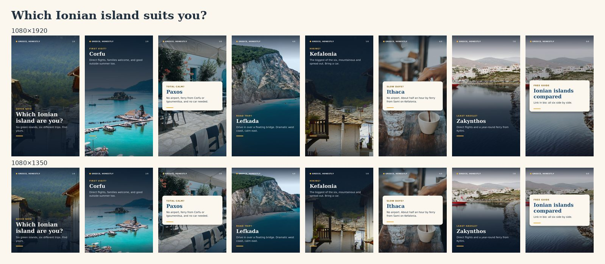

**Caption**

Corfu, Paxos, Lefkada, Kefalonia, Ithaca or Zakynthos? Six Ionian islands, six kinds of trip. Which one is yours? AI characters, written in Greece. #ionianislands #greece #corfu #lefkada #kefalonia #travelquiz

## AMKA: myths vs facts

Folder: [`22-amka-myths/`](22-amka-myths/) · format: Myths vs facts · links to https://vasilismis.github.io/greece-honestly/articles/amka-explained/

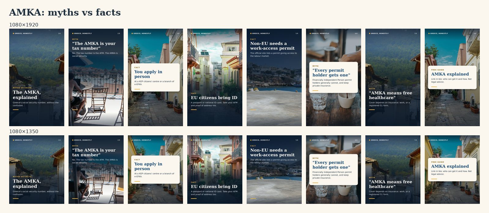

**Caption**

The AMKA is not your tax number, and not every residence permit gets one. Greece's social security number, explained in eight slides. AI characters, written in Greece. #movingtogreece #greece #expatlife #greekbureaucracy #retireingreece #movingabroad

## Moving to Greece in numbers

Folder: [`23-moving-numbers/`](23-moving-numbers/) · format: Money numbers · links to https://vasilismis.github.io/greece-honestly/articles/first-90-days-in-greece/

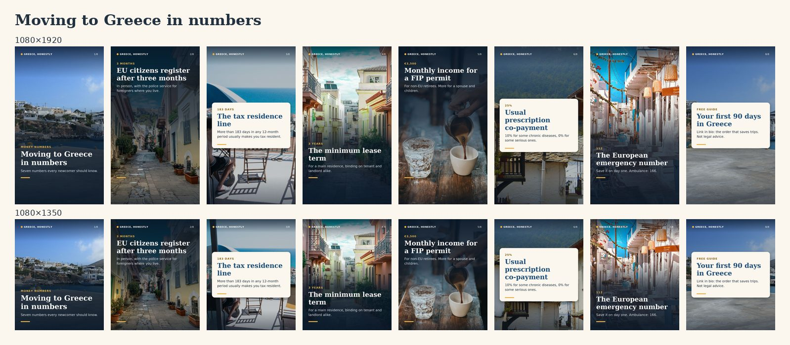

**Caption**

Three months, 183 days, three years, €3,500, 25% and 112. The numbers that shape your first year in Greece. AI characters, written in Greece. #movingtogreece #greece #expatlife #movingabroad #greeklife #newbeginnings

## Read these Greek signs

Folder: [`24-signs-quiz/`](24-signs-quiz/) · format: Quiz · links to https://vasilismis.github.io/greece-honestly/articles/how-to-read-greek-signs-alphabet/

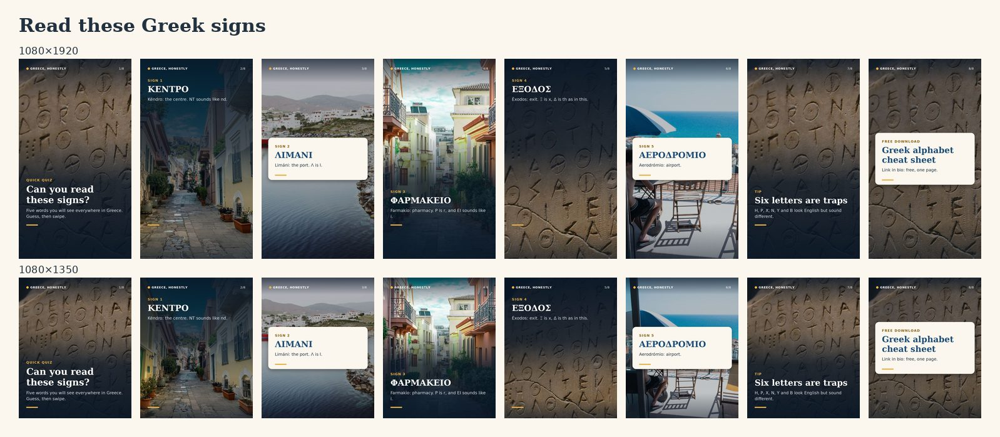

**Caption**

ΚΕΝΤΡΟ, ΛΙΜΑΝΙ, ΦΑΡΜΑΚΕΙΟ, ΕΞΟΔΟΣ, ΑΕΡΟΔΡΟΜΙΟ. Five signs you will meet in your first hour in Greece. Can you read them? AI characters, written in Greece. #greekalphabet #learngreek #greece #greeklanguage #languagelearning #travelgreece

## Athens transport: myths vs facts

Folder: [`25-athens-transport-myths/`](25-athens-transport-myths/) · format: Myths vs facts · links to https://vasilismis.github.io/greece-honestly/articles/where-to-live-in-athens/

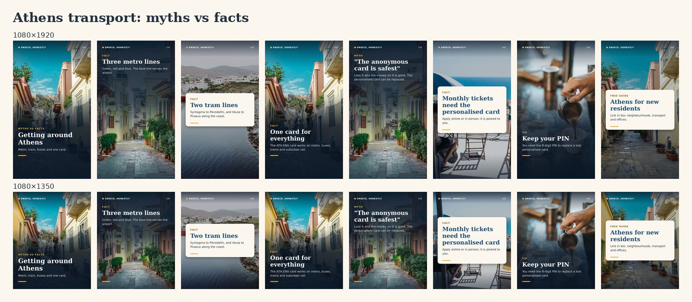

**Caption**

Three metro lines, two tram lines and one card. What new residents should know about getting around Athens, and which ATH.ENA card to get. AI characters, written in Greece. #athens #athensgreece #movingtogreece #publictransport #expatlife #greece

## Lefkada beaches, as they are today

Folder: [`26-lefkada-beaches/`](26-lefkada-beaches/) · format: Things locals do · links to https://vasilismis.github.io/greece-honestly/articles/lefkada-travel-guide/

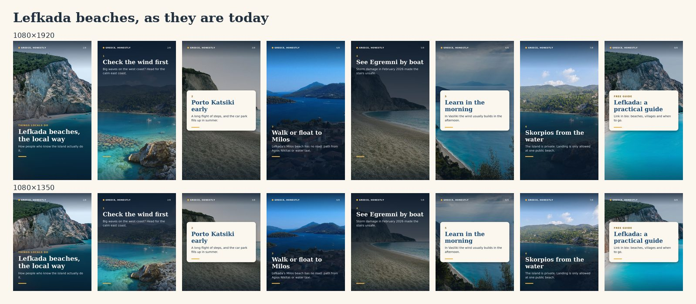

**Caption**

Wind first, Porto Katsiki early, Egremni by boat. How to do Lefkada's beaches as they really are today. AI characters, written in Greece. #lefkada #lefkas #ionianislands #greekislands #greece #beachlife

## Zakynthos: rules to know

Folder: [`27-zakynthos-rules/`](27-zakynthos-rules/) · format: Things locals do · links to https://vasilismis.github.io/greece-honestly/articles/ionian-islands-compared/

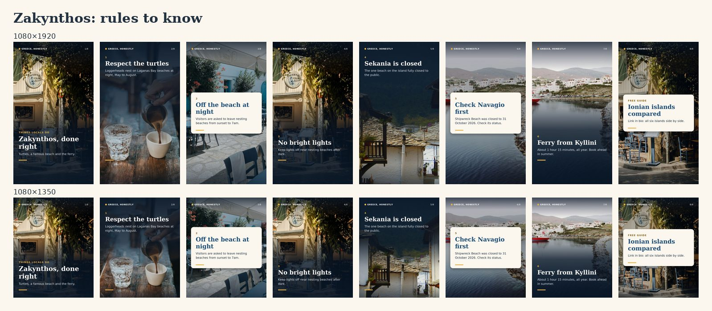

**Caption**

Turtle beaches at night, a closed beach and a famous shipwreck. What to know before Zakynthos, so you do it right. AI characters, written in Greece. #zakynthos #zante #ionianislands #seaturtles #greece #responsibletravel

## Renting in Greece in numbers

Folder: [`28-renting-numbers/`](28-renting-numbers/) · format: Money numbers · links to https://vasilismis.github.io/greece-honestly/articles/renting-a-flat-in-greece/

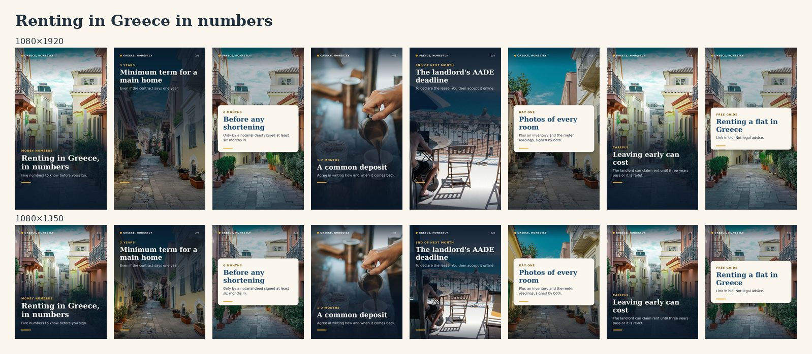

**Caption**

Three years, six months, one to two months' deposit. The numbers behind a Greek lease, and why leaving early can cost you. AI characters, written in Greece. #rentingreece #athens #greece #expatlife #movingabroad #firstapartment

## At the taverna: say this

Folder: [`29-taverna-say-this/`](29-taverna-say-this/) · format: Say this, not that · links to https://vasilismis.github.io/greece-honestly/articles/what-to-order-in-a-greek-taverna/

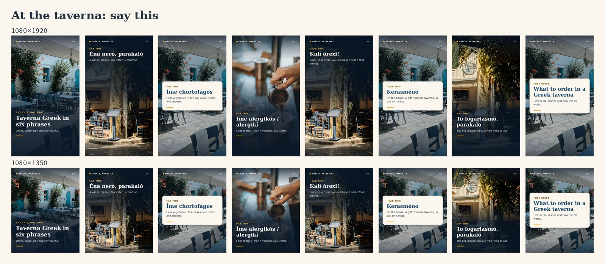

**Caption**

Water, vegetarian, allergic, on the house and the bill. Six bits of taverna Greek that make every meal easier. AI characters, written in Greece. #greekfood #learngreek #taverna #greece #greekphrases #eatlikealocal

## Kefalonia and Ithaca: myths vs facts

Folder: [`30-kefalonia-ithaca-myths/`](30-kefalonia-ithaca-myths/) · format: Myths vs facts · links to https://vasilismis.github.io/greece-honestly/articles/ionian-islands-compared/

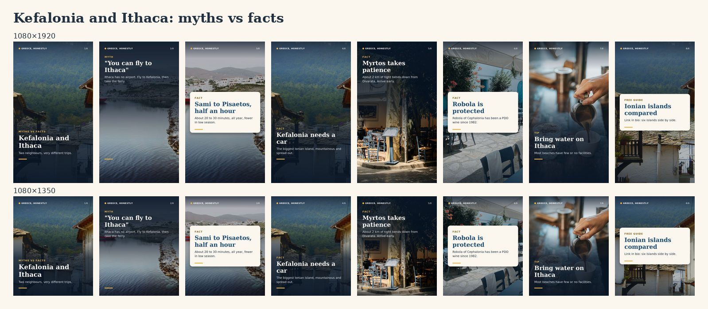

**Caption**

No airport on Ithaca, tight bends to Myrtos and a protected wine since 1982. What to know about Kefalonia and Ithaca. AI characters, written in Greece. #kefalonia #ithaca #ionianislands #greekislands #greece #travelplanning
